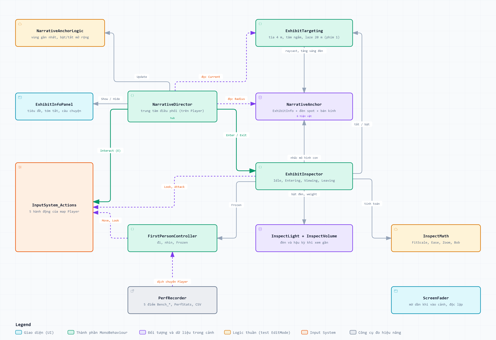
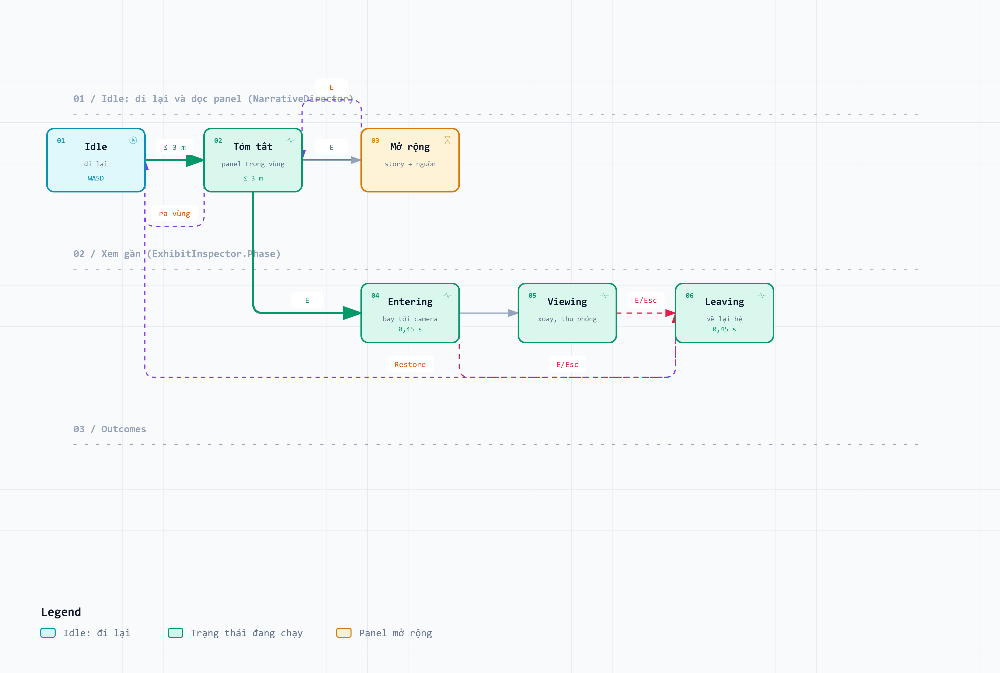
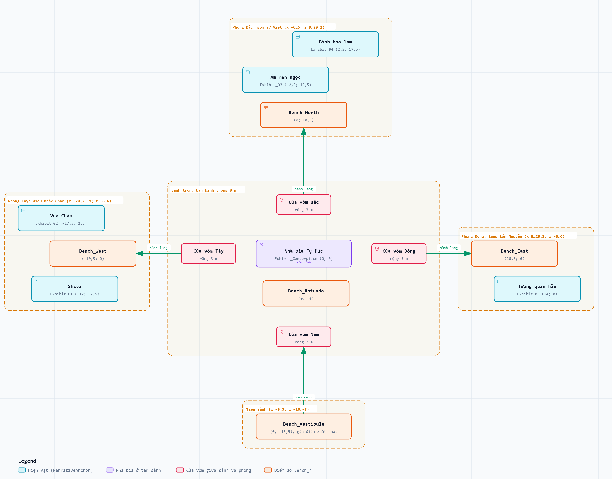
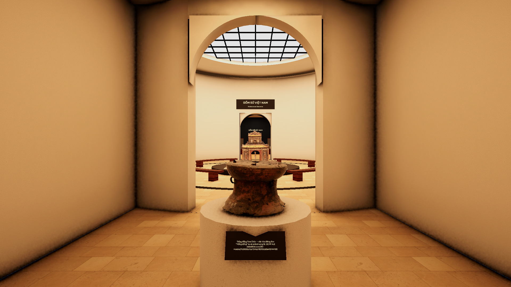
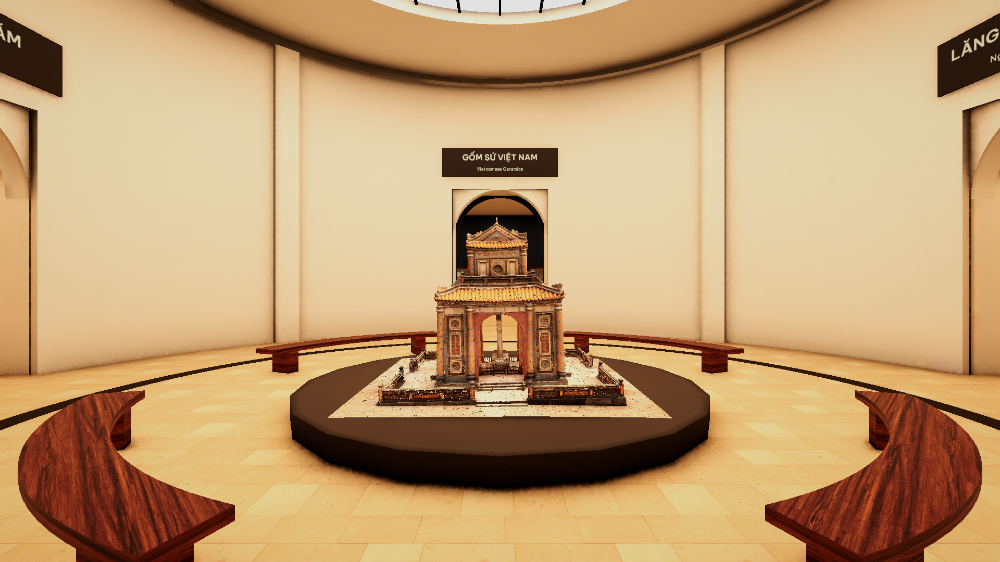
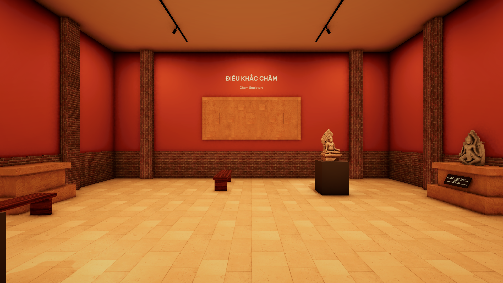
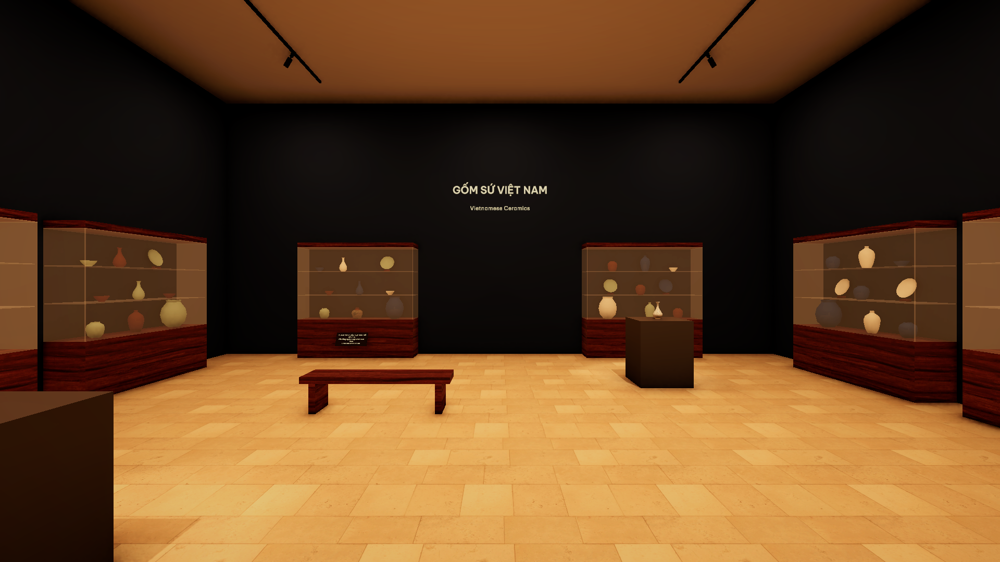
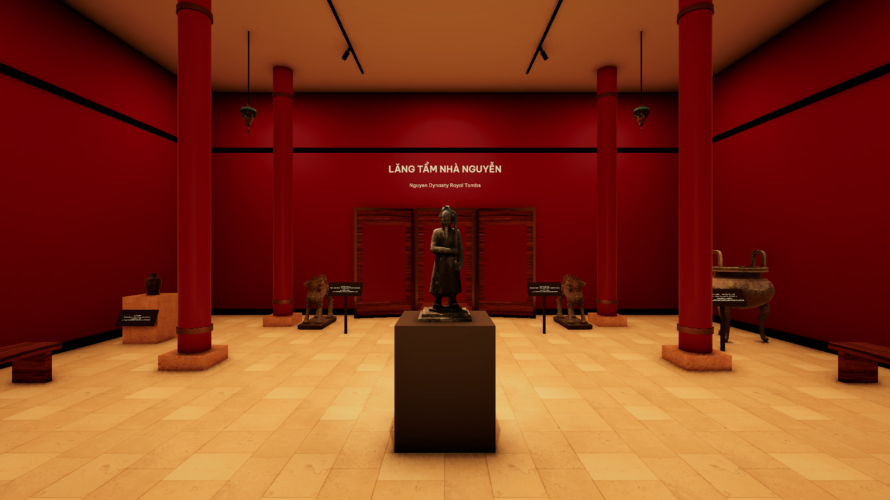
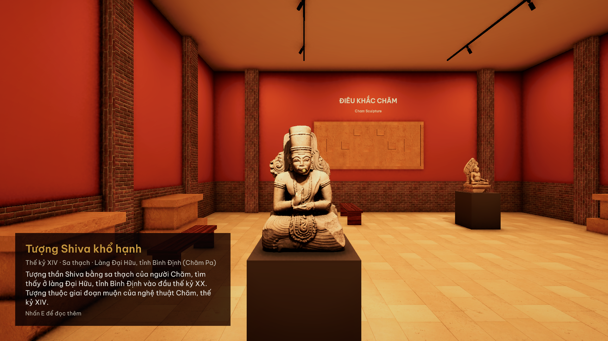
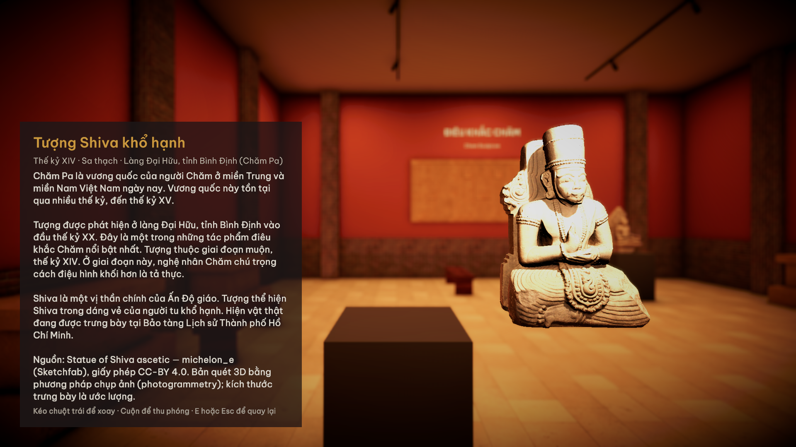

# Tư liệu viết báo cáo cuối kỳ — Bảo tàng ảo, đề 28

**Người đọc:** thành viên phụ trách viết báo cáo học phần INF1353 — Phát triển ứng dụng thực tế ảo.

**Mục đích:** cung cấp nội dung, số liệu, bảng và hình để viết báo cáo theo mục A của đề thi. Đây là tài liệu hỗ trợ, không phải bản tiểu luận đã định dạng theo mẫu trường.

**Ngày tổng hợp:** 22/10/2026. **Đề tài:** Bảo tồn di sản văn hóa và các di tích lịch sử bằng kỹ thuật photogrammetry.

## 1. Cách dùng tài liệu

Dùng mục 2–3 để viết phần phân tích và thiết kế. Dùng mục 4–5 để trình bày sản phẩm. Dùng mục 6–8 cho kiểm thử, đo lường, tối ưu và hạn chế. Giữ ghi chú dưới bảng, hình khi chuyển sang Word.

Mục B và Phụ lục 02 của đề chỉ dùng để đối chiếu yêu cầu, không phải chương nội dung. Theo phạm vi đã thống nhất, tài liệu không lập chương riêng cho Câu 4. Video thuộc phần nộp bổ sung sau; không cản việc viết nội dung hiện tại.

**Bảng 1. Bản đồ nội dung theo mục A.**

| Yêu cầu | Tư liệu dùng trong file này | Điểm tối đa |
|---|---|---:|
| Câu 1a–1d: bài toán, mục tiêu, ràng buộc, tiêu chí kiểm chứng | Mục 2; bảng 2–4 | 1,5 |
| Câu 2a–2d: phương án, công nghệ, kiến trúc, trải nghiệm | Mục 3; bảng 5–7; hình 1–3 | 2,0 |
| Câu 3a: phát triển và tích hợp | Mục 4–5; bảng 8; hình 4–10 | 3,0 |
| Câu 3b: kiểm thử, đo lường, tối ưu, hạn chế | Mục 6–8; bảng 9–18 | 2,0 |

*Ghi chú:* trọng số dùng để phân bổ nội dung. Chúng không phải điểm đã đạt. Câu 4 vẫn thuộc đề gốc, dù không viết thành mục riêng trong tài liệu hỗ trợ này.

Quy ước bằng chứng:

- **Có tệp đối chứng:** có CSV, ảnh hoặc log để kiểm tra phát biểu.
- **Theo hồ sơ:** đã ghi trong tài liệu dự án, nhưng chưa có kết quả gốc tương ứng trong bộ hồ sơ này.
- **Ước tính:** tính từ giả định và dữ liệu đầu vào; không gọi là số đo trực tiếp.
- **Chưa đối chứng:** chưa đủ chứng cứ kết luận đạt hoặc không đạt. Không đồng nghĩa với test thất bại.

## 2. Phân tích bài toán và yêu cầu — Câu 1

### 2.1. Bài toán, người dùng và phạm vi

Ảnh hai chiều chỉ thể hiện hiện vật từ các góc chụp cố định. Người học khó quan sát mặt sau, hình khối và quan hệ giữa các bộ phận. Việc đến trực tiếp di tích còn phụ thuộc vị trí và điều kiện đi lại.

Sản phẩm xây dựng một bảo tàng 3D trên Windows. Người xem đi qua các khu trưng bày, đọc thuyết minh tiếng Việt và xoay mô hình để xem gần. Nhóm người dùng mục tiêu gồm học sinh, sinh viên và người muốn tìm hiểu di sản từ xa. Đây là đối tượng thiết kế, chưa phải kết quả khảo sát nhu cầu.

Trọng tâm nội dung gồm điêu khắc Chăm, gốm Việt và kiến trúc, hiện vật thời Nguyễn. Ứng dụng có sáu hiện vật chính gắn nội dung và tương tác. Danh mục tài nguyên thống kê riêng gồm 18 mô hình; không dùng con số này để suy ra số bản quét đang hoạt động trong scene.

Giá trị bảo tồn của sản phẩm nằm ở phổ biến tri thức và tiếp cận bản sao số. Mô hình đã giảm lưới và thay đổi tỷ lệ trưng bày không thay thế hồ sơ đo đạc, khảo cổ hoặc trùng tu.

### 2.2. Mục tiêu và yêu cầu chức năng

Mục tiêu trải nghiệm là hoàn thành một vòng tham quan: **đi → đọc → chọn hiện vật → xem gần → quay lại tham quan**. Việc thoát xem gần phải trả hiện vật và quyền điều khiển về trạng thái trước đó.

**Bảng 2. Yêu cầu chức năng và nơi đối chứng.**

| Mã | Yêu cầu | Hành vi cần trình bày | Bằng chứng hiện có |
|---|---|---|---|
| F01 | Di chuyển và quan sát | WASD để đi, chuột để nhìn, Shift để đi nhanh; Esc mở con trỏ | Hướng dẫn dự án; `FirstPersonControllerTests` |
| F02 | Đọc thuyết minh theo vị trí | Hiện bảng cho hiện vật gần nhất trong vùng; ra vùng thì ẩn | Hình 9; `NarrativeAnchorLogicTests`, `NarrativeDirectorPlayModeTests` |
| F03 | Nhắm chọn hiện vật | Tia nhắm nhận diện hiện vật; tâm ngắm và đèn phản hồi | `ExhibitTargetingTests` |
| F04 | Xem gần, xoay và thu phóng | E mở xem gần; kéo chuột xoay; cuộn chuột thu phóng | Hình 10; `ExhibitInspectorTests` |
| F05 | Thoát và phục hồi | E/Esc trả mô hình về bệ, khôi phục va chạm và điều khiển | `Exit_RestoresExactLocalPose`, `Exit_RestoresSideEffects` |
| F06 | Bật bút laze | Phím 1 bật/tắt; tầm nhắm tăng từ 4 m lên 20 m | `Digit1_TogglesLaser`, `ExhibitTargetingTests` |

*Ghi chú:* tên test chỉ tới mã kiểm thử trong [thư mục Tests](../../Assets/Museum/Tests). Có test chưa đồng nghĩa test đã được chạy đạt. Kết quả và giới hạn bằng chứng được tách riêng tại mục 6.1.

### 2.3. Ràng buộc và yêu cầu phi chức năng

**Bảng 3. Yêu cầu phi chức năng.**

| Mã | Yêu cầu hoặc ràng buộc | Cách thể hiện trong báo cáo |
|---|---|---|
| NF01 | Chạy trên Windows 64-bit bằng bàn phím và chuột | Nêu rõ nền tảng đã làm; chưa hỗ trợ kính VR |
| NF02 | Mục tiêu FPS trung bình ≥60 tại mỗi điểm đo | Dùng bảng 13; chỉ kết luận trong cấu hình và kịch bản đã đo |
| NF03 | Mục tiêu p99 thời gian khung hình ≤33 ms | Dùng bảng 13; bổ sung đánh giá phần khung hình chậm |
| NF04 | Đọc được tiếng Việt | Dùng Be Vietnam Pro; đối chiếu hình 9–10 và test glyph, bố cục |
| NF05 | Không làm mất trạng thái hiện vật khi xem gần | Đối chiếu test phục hồi vị trí, tỷ lệ, va chạm và điều khiển |
| NF06 | Truy xuất được nguồn tài nguyên | Giữ `SOURCE.txt`, tác giả, giấy phép và nguồn nội dung |

*Ghi chú:* đây là yêu cầu tổng hợp cho phạm vi hiện tại. Không mô tả chúng là bộ yêu cầu đã được lập từ đầu nếu không có lịch sử chứng minh.

**Căn cứ ngưỡng hiệu năng:** chọn 60 FPS làm mục tiêu trải nghiệm desktop, tương ứng khoảng 16,67 ms/khung hình. Thêm p99 ≤33 ms để giới hạn phần lớn các khung hình chậm ở khoảng hai lần ngân sách đó. Đây là ngưỡng do nhóm chọn, không phải ngưỡng bắt buộc của đề, chuẩn cho kính VR hoặc bảo đảm không gây say chuyển động.

RTX 4050 Laptop là GPU của máy đo. Không gọi đây là cấu hình tối thiểu. Giới hạn góc nhìn ±85° và hiệu ứng chuyển cảnh là lựa chọn thiết kế; hiệu quả giảm khó chịu chưa được đánh giá với người dùng.

### 2.4. Tiêu chí kiểm chứng

**Bảng 4. Các tiêu chí đo mức hoàn thành.**

| Mã | Tiêu chí | Cách kiểm chứng | Trạng thái hồ sơ |
|---|---|---|---|
| K01 | FPS trung bình ≥60 ở cả 5 điểm | Kiểm tra cả ba lượt và trung vị mỗi điểm | 15/15 đoạn đo đạt ngưỡng theo CSV |
| K02 | p99 ≤33 ms ở cả 5 điểm | Kiểm tra cả ba lượt và trung vị mỗi điểm | 15/15 đoạn đo đạt ngưỡng theo CSV |
| K03 | Toàn bộ test liên quan chạy đạt | Kết quả gốc EditMode và PlayMode trên dự án hiện tại | 143/143 đạt; 0 lỗi; 0 bỏ qua; có JSON chi tiết |
| K04 | Đến được và nhắm được sáu hiện vật chính | `EveryExhibit_IsReachableOnFoot`, `EveryExhibit_IsTargetableFromItsStandingSpot` | Cả hai test đạt; kiểm tra thủ công tuyến tham quan chưa chạy lại |

*Ghi chú:* các tiêu chí có thể dùng làm bảng nghiệm thu. Không cộng chúng thành tỷ lệ hoàn thành chức năng; tỷ lệ đó cần kết quả đối chiếu từng yêu cầu F01–F06.

## 3. Lựa chọn công nghệ và thiết kế — Câu 2

### 3.1. So sánh phương án

**Bảng 5. Ba phương án triển khai theo năm tiêu chí.**

| Tiêu chí | Desktop Unity URP — chọn | Kính VR qua OpenXR | Unity Web/WebGL |
|---|---|---|---|
| Thiết bị | Máy tính Windows, bàn phím, chuột | Kính và thiết bị tương tác phù hợp runtime | Máy có trình duyệt tương thích |
| Tiếp cận sản phẩm | Tải và chạy gói Windows | Cần bố trí thiết bị và cấu hình trải nghiệm | Có thể phân phối qua đường dẫn sau khi triển khai |
| Cách quan sát | Màn hình, góc nhìn thứ nhất; thao tác bằng chuột | Thiết kế theo chuyển động đầu và thiết bị điều khiển | Thiết kế thao tác trong trình duyệt |
| Phần việc với dự án hiện có | Đã có điều khiển, build và dữ liệu đo | Cần tích hợp XR, thiết kế lại tương tác và thử trên kính | Cần build riêng, kiểm tra giới hạn nền tảng và cách tải tài nguyên |
| Bằng chứng hiệu năng hiện có | Ba lượt benchmark trên Windows | Chưa đo | Chưa đo |

*Ghi chú:* đây là so sánh phạm vi và công sức triển khai, không phải phép đo ba nền tảng. Nhận định về phần việc là phân tích từ hiện trạng dự án. Không kết luận desktop nhanh hơn hai phương án còn lại.

Unity mô tả OpenXR là cầu nối tới thiết bị có runtime tương thích; cấu hình phải phù hợp phần cứng thử nghiệm. Unity Web có các giới hạn riêng về API, trình duyệt và truy cập hệ thống. Nguồn: [Unity OpenXR Plugin](https://docs.unity3d.com/Packages/com.unity.xr.openxr@1.14/manual/index.html), [Unity 6.3 — Web technical limitations](https://docs.unity3d.com/6000.3/Documentation/Manual/webgl-technical-overview.html), truy cập 22/10/2026.

**Lý do chọn:** bản desktop tận dụng hệ điều khiển, tài nguyên và bộ kiểm thử đã có. Nhóm có thể tập trung xử lý mô hình và trải nghiệm tham quan trên nền tảng đã đo. Lựa chọn này đồng thời giới hạn sản phẩm ở trải nghiệm 3D trên màn hình.

### 3.2. Công nghệ đang dùng

**Bảng 6. Công nghệ và vai trò.**

| Thành phần | Phiên bản hoặc lựa chọn | Vai trò trong sản phẩm |
|---|---|---|
| Unity Editor | 6000.3.26f1 | Quản lý scene, tài nguyên và build Windows |
| Ngôn ngữ | C# | Điều khiển, tương tác, quản lý trạng thái và đo hiệu năng |
| Universal Render Pipeline | 17.3.0 | Dựng hình, vật liệu, ánh sáng và hậu kỳ |
| Input System | 1.20.0 | Nhận thao tác bàn phím và chuột |
| Unity Test Framework | 1.6.0 | Chạy EditMode và PlayMode |
| TextMesh Pro; Be Vietnam Pro | Font đã có trong dự án | Hiển thị nội dung tiếng Việt |
| Dữ liệu hiện vật | `ExhibitInfo` và `narration_vi.json` | Tách nội dung khỏi logic tương tác |

*Nguồn:* [ProjectVersion.txt](../../ProjectSettings/ProjectVersion.txt), [manifest.json](../../Packages/manifest.json), [README](../../README.md). Hai mức đồ họa PC/Mobile có trong cấu hình; bộ số đo dưới đây chỉ thuộc Windows.

### 3.3. Kiến trúc và luồng dữ liệu

`NarrativeDirector` điều phối việc đọc thông tin và mở xem gần. `NarrativeAnchorLogic` chọn vùng gần nhất; `ExhibitTargeting` xác định hiện vật đang được nhắm. `ExhibitInfoPanel` trình bày nội dung từ `ExhibitInfo`. `ExhibitInspector` quản lý mô hình trong lúc xem gần và phục hồi khi thoát.

*Hình 1. Kiến trúc thành phần. Các đường nối thể hiện quan hệ gọi hoặc đọc dữ liệu. `ScreenFader` hoạt động độc lập; `PerfRecorder` phục vụ đo hiệu năng. Nguồn: sơ đồ dự án ngày 22/10/2026. Không diễn giải sơ đồ này như hệ thống có máy chủ hay cơ sở dữ liệu mạng.*

**Bảng 7. Quy tắc tương tác và ưu tiên phím E.**

| Tình huống | Kết quả cần mô tả |
|---|---|
| Ở trong vùng, không nhắm hiện vật, nhấn E | Mở rộng hoặc thu gọn bảng thông tin |
| Đang nhắm hiện vật hợp lệ, nhấn E | Mở xem gần hiện vật được nhắm; ưu tiên hơn vùng đang đứng |
| Đang xem gần, nhấn E hoặc Esc | Yêu cầu thoát; trả mô hình về bệ và phục hồi điều khiển |
| Mô hình đang đi ra, nhấn thoát | Chuyển sang quay về từ trạng thái hiện tại |
| Đang quay về, nhấn thoát tiếp | Không tạo thêm lượt thoát |
| Đang xem gần, kéo chuột hoặc cuộn | Xoay mô hình hoặc thay đổi zoom trong khoảng 0,6–1,6 lần |

*Ghi chú:* vị trí quyết định bảng đọc; hướng nhìn quyết định hiện vật mở xem gần. Tầm nhắm thường là 4 m; bật laze là 20 m. Không yêu cầu phải đứng trong vùng đọc mới được xem gần một hiện vật đang nhắm hợp lệ.

*Hình 2. Bốn trạng thái xem gần: Idle → Entering → Viewing → Leaving → Idle. Hai nhánh E trên hình có điều kiện khác nhau: không nhắm thì đổi bảng đọc; có nhắm hợp lệ thì mở xem gần. Cạnh đi từ “Tóm tắt” sang “Entering” minh họa một tình huống, không phải điều kiện bắt buộc. Bán kính đọc là 3 m, riêng nhà bia 3,5 m. Khi phục hồi, bảng được xác định lại theo vị trí người chơi.*

### 3.4. Không gian và kịch bản

*Hình 3. Mặt bằng gồm tiền sảnh phía nam, sảnh tròn ở giữa và ba phòng chủ đề. Bắc ở trên; tọa độ là (x; z), đơn vị mét. Sơ đồ không theo tỷ lệ. Các điểm `Bench_*` là vị trí đo hiệu năng, không phải hiện vật.*

Người chơi bắt đầu ở tiền sảnh, đi vào sảnh tròn rồi chọn phòng. Sảnh giữa trưng bày nhà bia Tự Đức. Phòng Tây giới thiệu điêu khắc Chăm; phòng Bắc giới thiệu gốm; phòng Đông giới thiệu di sản thời Nguyễn.

Kịch bản minh họa nên theo một hiện vật: đi tới ấm men ngọc, đọc tóm tắt, mở câu chuyện, nhắm để xem gần, xoay và thu phóng, rồi thoát. Có thể dùng laze để minh họa nhắm một hiện vật ở xa. Nguồn thao tác: [kịch bản demo](../thuyet_trinh/02_kich_ban_slide_07-16.md).

## 4. Dữ liệu di sản và quá trình xây dựng — Câu 3a

### 4.1. Sáu hiện vật chính

**Bảng 8. Nội dung cho phần giới thiệu bộ sưu tập.**

| Hiện vật | Niên đại theo hồ sơ nội dung | Vị trí | Nguồn mô hình và giấy phép |
|---|---|---|---|
| Tượng Shiva khổ hạnh | Thế kỷ XIV | Phòng Tây | michelon_e; CC BY 4.0 |
| Vua Chăm được thần hóa | Cuối thế kỷ X | Phòng Tây | Minneapolis Institute of Art; CC0 |
| Ấm men ngọc có nắp | Thế kỷ XIII–XIV | Phòng Bắc | Minneapolis Institute of Art; CC0 |
| Bình hoa lam dáng quả lê | Cuối thế kỷ XV | Phòng Bắc | Minneapolis Institute of Art; CC0 |
| Tượng quan hầu ở lăng Khải Định | Đầu thế kỷ XX | Phòng Đông | eyesCloud3D; CC BY 4.0 |
| Nhà bia lăng Tự Đức | 1864–1867 | Sảnh tròn | vashar; dữ liệu CyArk; CC BY 4.0 |

*Nguồn:* [narration_vi.json](../narration_vi.json) và `SOURCE.txt` của từng mô hình. Niên đại là nội dung theo hồ sơ dự án, không phải kết quả định tuổi do nhóm thực hiện. Nhà bia là mô hình thu nhỏ; không suy ra kích thước thật từ ứng dụng.

### 4.2. Phần việc của nhóm trong chuỗi photogrammetry

Photogrammetry là tái dựng hình học từ ảnh chụp ở nhiều góc. Dự án tiếp nhận mô hình đã được công bố, sau đó xử lý để sử dụng trong môi trường tương tác. Nhóm không thực hiện một đợt chụp và tái dựng hiện vật mới.

1. Chọn mô hình và ghi nguồn, tác giả, giấy phép, tình trạng dữ liệu quét.
2. Kiểm tra hình học; gỡ nền hoặc phần thừa theo hồ sơ của từng mô hình.
3. Giảm số tam giác ở mô hình nặng; không phải mọi mô hình đều giảm lưới.
4. Tạo normal map từ lưới chi tiết khi phù hợp, để giữ biểu hiện bề mặt trên lưới nhẹ.
5. Chuẩn hóa hướng, tỷ lệ trưng bày, vật liệu và kích thước texture.
6. Đưa vào Unity; bố trí bệ, ánh sáng, vùng tương tác và thuyết minh.
7. Kiểm thử hành vi, đo hiệu năng và lưu số liệu trước–sau.

Normal map là ảnh mô tả hướng bề mặt dùng khi tính ánh sáng. Nó không phục hồi toàn bộ hình học đã mất sau giảm lưới. Với nhà bia Tự Đức, hồ sơ ghi dữ liệu CyArk kết hợp LiDAR và photogrammetry; không gọi đó là quy trình chỉ dùng ảnh.

### 4.3. Tổ chức tài nguyên và tích hợp

Scene chính là [Museum.unity](../../Assets/Museum/Scenes/Museum.unity). Mã tương tác nằm trong [Scripts](../../Assets/Museum/Scripts); thông tin hiện vật ở [Content](../../Assets/Museum/Content). Mỗi model có thư mục riêng trong [Models](../../Assets/Museum/Models), kèm tài liệu nguồn và texture.

Các thành phần được gán tham chiếu trong scene. Khi mở xem gần, hệ thống lưu trạng thái của mô hình, khóa điều khiển người chơi và điều chỉnh hiển thị. Khi thoát, hệ thống phục hồi vị trí, hướng, tỷ lệ và các thành phần liên quan. Logic thuần được tách để kiểm thử EditMode; hành vi tương tác được kiểm thử PlayMode.

## 5. Ảnh sản phẩm để đưa vào báo cáo

Các ảnh dưới đây có sẵn trong `img/`, kích thước 1920 × 1080. Chúng minh họa kết quả hiển thị tại lúc chụp. Không dùng ảnh tĩnh thay cho kết quả kiểm thử cả chuỗi thao tác.

*Hình 4. Tiền sảnh và hướng vào sảnh trung tâm. Trống Tam Chúc đặt trên bệ, có bảng ghi công. Dùng cho phần bố cục và tổ chức trưng bày. Nguồn: ảnh dự án ngày 22/10/2026.*

*Hình 5. Nhà bia Tự Đức ở giữa sảnh tròn; cửa vòm dẫn sang các phòng. Dùng cho phần kết quả xây dựng môi trường 3D. Nguồn: ảnh dự án ngày 22/10/2026.*

*Hình 6. Phòng Tây với các bệ tượng và phần trang trí tường. Dùng để trình bày phân khu chủ đề. Không dùng ảnh này để xác nhận nguồn quét của mọi vật trang trí. Nguồn: ảnh dự án ngày 22/10/2026.*

*Hình 7. Phòng Bắc gồm tủ trưng bày và bệ hiện vật chính. Dùng để minh họa bố trí không gian; các món trang trí không mặc nhiên có cùng chức năng với hiện vật chính. Nguồn: ảnh dự án ngày 22/10/2026.*

*Hình 8. Phòng Đông với tượng quan hầu, đỉnh đồng và các mô hình trang trí. Dùng cho phần tích hợp tài nguyên và ánh sáng. Nguồn: ảnh dự án ngày 22/10/2026.*

*Hình 9. Bảng thuyết minh tiếng Việt hiển thị cạnh hiện vật: tên, niên đại, chất liệu, nguồn gốc và tóm tắt. Ảnh chứng minh trạng thái hiển thị; việc tự mở theo khoảng cách cần đối chiếu kiểm thử. Nguồn: ảnh dự án ngày 22/10/2026.*

*Hình 10. Chế độ xem gần đặt mô hình bên phải và câu chuyện bên trái. Dòng cuối hướng dẫn xoay, thu phóng và thoát. Ảnh không chứng minh độ chính xác hình học hoặc mức giữ chi tiết sau tối ưu. Nguồn: ảnh dự án ngày 22/10/2026.*

## 6. Kiểm thử và đo lường — Câu 3b

### 6.1. Số liệu kiểm thử tự động

**Bảng 9. Kết quả chạy lại qua UnityMCP ngày 22/10/2026.**

| Bộ kiểm thử | Đã chạy | Đạt | Lỗi | Bỏ qua | Kết quả gốc |
|---|---:|---:|---:|---:|---|
| EditMode | 78 | 78 | 0 | 0 | [JSON: 78 ca](data/results_editmode.json) |
| PlayMode | 65 | 65 | 0 | 0 | [JSON: 65 ca](data/results_playmode.json) |
| Tổng | 143 | 143 | 0 | 0 | Đã đối chiếu đủ 143 tên test và trạng thái Passed |

*Nguồn:* phản hồi gốc `get_test_job` của UnityMCP, có kết quả tổng và chi tiết từng ca. Luna chạy hai bộ tuần tự trên Unity 6000.3.26f1; đã kiểm tra số ca chi tiết khớp tổng, không trùng tên và đều Passed. Không suy ra độ bao phủ mã nguồn hoặc tỷ lệ hoàn thành chức năng từ số này.

Theo thời gian job, EditMode chạy lúc 21:36:08–21:36:13; PlayMode chạy lúc 21:37:36–21:38:01, ngày 22/10/2026 (UTC+7). Thời lượng thực thi test do framework báo: 1,795248 giây và 18,5980144 giây. Hai file là JSON do MCP trả về; không tạo XML thay thế. Lần khởi tạo đầu bị timeout trước khi chạy ca nào, nên không tính là một test thất bại.

Kết quả này thuộc mã nguồn và scene trong Editor ở thời điểm chạy. Nó không tự xác nhận bản build dùng cho benchmark trước đó có cùng nội dung. Năm log lỗi về thiếu tham chiếu là đầu ra chủ ý của các ca kiểm thử lỗi và các ca đó đều đạt.

**Bảng 10. Các ca kiểm thử đại diện đã đối chiếu với kết quả gốc.**

| Mã | Điều kiện hoặc thao tác | Kết quả mong đợi | Test có trong mã nguồn | Kết quả thực tế từng ca |
|---|---|---|---|---|
| T01 | Người chơi không bị khóa, giữ W | Người chơi di chuyển | `NotFrozen_MovesWithW` | Đạt |
| T02 | Bật Frozen, gửi thao tác đi và nhìn | Không di chuyển hoặc xoay theo input | `Frozen_IgnoresMoveAndLook` | Đạt |
| T03 | Người chơi đứng đúng biên vùng đọc | Vùng vẫn được chọn | `FindNearest_ExactlyOnBoundary_Included` | Đạt |
| T04 | Danh sách vị trí và bán kính khác độ dài | Báo đầu vào không hợp lệ | `FindNearest_CountMismatch_Throws` | Đạt |
| T05 | Trong vùng đọc, không nhắm, nhấn E | Chuyển tóm tắt/mở rộng | `PressE_NotAiming_TogglesAsBefore` | Đạt |
| T06 | Đang nhắm, nhấn E | Mở xem gần và câu chuyện hiện vật được nhắm | `PressE_WhileAiming_EntersInspectWithExpandedStory` | Đạt |
| T07 | Thoát khi mô hình đang đi ra | Mô hình quay về bệ | `ExitDuringEnter_ReturnsHome` | Đạt |
| T08 | Thoát chế độ xem gần | Phục hồi đúng vị trí, hướng và tỷ lệ cục bộ | `Exit_RestoresExactLocalPose` | Đạt |
| T09 | Nhấn phím 1 | Bật/tắt laze | `Digit1_TogglesLaser` | Đạt |
| T10 | Mở rộng nội dung dài | Nội dung vừa khung ở các cỡ khung được test | `LongestStory_Expanded_FitsInsideFrame` | Đạt 2/2 |
| T11 | Tính thống kê từ dãy có giá trị không hợp lệ | Chỉ dùng mẫu dương, hữu hạn | `Compute_MixedInvalid_IgnoresInvalidValues` | Đạt |
| T12 | Benchmark có hai điểm thử | Có CSV đúng cấu trúc; kết thúc tại điểm cuối | `Benchmark_TwoPoints_WritesCsvAndEndsAtLastPoint` | Đạt |
| T13 | Bộ đo thiếu danh sách điểm | Báo lỗi và tắt thành phần | `Benchmark_NoPoints_LogsErrorAndDisables` | Đạt |
| T14 | Xét vị trí đứng của từng hiện vật chính | Có thể đến và nhắm hiện vật | `EveryExhibit_IsReachableOnFoot`, `EveryExhibit_IsTargetableFromItsStandingSpot` | Đạt 2/2 |

*Ghi chú:* kết quả thực tế lấy từ hai JSON ở bảng 9. T10 có hai ca với chiều cao khung 1080 và 935; T14 gồm hai test khác nhau. Bảng 14 hàng đại diện 16 ca, không thay thế danh sách đầy đủ 143 ca. Mã kiểm thử nằm ở [EditMode](../../Assets/Museum/Tests/EditMode) và [PlayMode](../../Assets/Museum/Tests/PlayMode).

### 6.2. Điều kiện đo hiệu năng

**Bảng 11. Môi trường và quy trình benchmark.**

| Thuộc tính | Giá trị | Nguồn hoặc giới hạn |
|---|---|---|
| Ngày đo | 22/10/2026 | Tên CSV gốc và ngày log |
| Nền tảng | Player Windows; Unity 6000.3.26f1 | Log player |
| GPU | NVIDIA GeForce RTX 4050 Laptop GPU | Log player |
| Bộ nhớ đồ họa thiết bị | Log báo 5.920 MB | Dung lượng thiết bị, không phải mức ứng dụng sử dụng |
| Graphics API | Direct3D 12 | Log player |
| CPU | Log báo Processor Count = 12 | Chưa lưu tên CPU; không gọi đây là 12 lõi vật lý |
| Màn hình | 1920 × 1080, toàn màn hình | Theo hồ sơ lần đo; log hiện có không ghi lại cấu hình này |
| VSync | Tắt | Theo hồ sơ lần đo; chưa có bản chụp cấu hình kèm theo |
| Loại build | Release | Theo hồ sơ lần đo |
| Điểm đo | Tiền sảnh → sảnh tròn → Tây → Bắc → Đông | Năm hàng trong mỗi CSV; sơ đồ hình 3 |
| Thời gian mỗi điểm | Chờ 2 giây, lấy mẫu 10 giây | Mặc định trong `PerfRecorder` và mô tả lần đo |
| Số lượt | 3 lượt × 5 điểm = 15 đoạn đo | Có đủ ba CSV, mỗi tệp năm điểm |
| Số mẫu hợp lệ | 58.775 khung hình | Tổng cột `samples` của 15 đoạn |

*Nguồn:* [log lượt 1](../../Builds/Windows/bench_check.log), [log lượt 2](../../Builds/Windows/bench_run2.log), [log lượt 3](../../Builds/Windows/bench_run3.log), [PerfRecorder.cs](../../Assets/Museum/Scripts/PerfRecorder.cs). Số mẫu từng lượt: 19.898; 19.805; 19.072. Đây là đo tại các điểm trong cảnh, chưa phải đo đầy đủ khi xoay và xem gần mọi hiện vật.

### 6.3. Định nghĩa chỉ số

**Bảng 12. Cách đọc và tính số liệu.**

| Cột CSV | Ý nghĩa và cách tính | Đơn vị |
|---|---|---|
| `samples` | Số mẫu thời gian khung hình hợp lệ | Khung hình |
| `avg_ms` | Trung bình thời gian khung hình, lấy từ `Time.unscaledDeltaTime` | ms |
| `avg_fps` | 1.000 chia cho `avg_ms` trước khi làm tròn | Khung hình/giây |
| `p95_ms`, `p99_ms` | Mẫu ở hạng làm tròn lên của n × 95% hoặc n × 99%, sau sắp tăng | ms |
| `low1_fps` | 1.000 chia thời gian trung bình của nhóm 1% khung hình chậm nhất; số mẫu làm tròn lên | Khung hình/giây |
| `draw_calls` | Trung bình bộ đếm Draw Calls Count trong đoạn đo | Lượt gọi vẽ/khung hình |
| `triangles` | Trung bình bộ đếm Triangles Count trong đoạn đo | Tam giác/khung hình |
| `sys_mem_mb` | System Used Memory chia 1.048.576 | MiB, dù tên cột dùng `mb` |
| `gfx_mem_mb` | Gfx Used Memory chia 1.048.576; −1 khi không có bộ đếm hợp lệ | MiB hoặc −1 |

*Nguồn:* [PerfStats.cs](../../Assets/Museum/Scripts/PerfStats.cs), [PerfRecorder.cs](../../Assets/Museum/Scripts/PerfRecorder.cs). p99 không phải độ trễ từ thao tác đến hình ảnh. “1% low” không bằng 1.000/p99. Giá trị VRAM −1 không có nghĩa ứng dụng dùng bộ nhớ âm hoặc bằng 0.

### 6.4. Kết quả chính

**Bảng 13. Trung vị từng chỉ số qua ba lượt đo.**

| Khu vực | FPS trung bình | Thời gian TB (ms) | p95 (ms) | p99 (ms) | FPS 1% low |
|---|---:|---:|---:|---:|---:|
| Tiền sảnh | 307,08 | 3,26 | 4,14 | 5,18 | 174,05 |
| Sảnh tròn | 347,09 | 2,88 | 3,94 | 4,81 | 194,90 |
| Phòng Tây | 443,80 | 2,25 | 2,88 | 3,43 | 273,64 |
| Phòng Bắc | 442,06 | 2,26 | 2,94 | 3,51 | 268,02 |
| Phòng Đông | 423,32 | 2,36 | 2,98 | 3,56 | 260,74 |

*Nguồn:* [perf_median.csv](data/perf_median.csv). Mỗi ô là trung vị riêng của cùng cột tại cùng điểm qua ba lượt. Không gộp toàn bộ khung hình của ba lượt để tính lại p99. File gốc dùng dấu chấm thập phân; bảng này dùng dấu phẩy.

**Bảng 14. Khối lượng dựng hình và bộ nhớ, trung vị qua ba lượt.**

| Khu vực | Draw calls/khung hình | Tam giác/khung hình | System Used Memory (MiB) |
|---|---:|---:|---:|
| Tiền sảnh | 683 | 4.362.897 | 761,4 |
| Sảnh tròn | 487 | 1.921.545 | 683,0 |
| Phòng Tây | 128 | 636.140 | 683,0 |
| Phòng Bắc | 210 | 507.780 | 683,0 |
| Phòng Đông | 172 | 1.589.395 | 685,4 |

*Ghi chú:* số tam giác dựng hình không đồng nhất với tổng tam giác của các file model. Nó thuộc hoạt động dựng cảnh ở điểm đo. Số bộ nhớ là bộ đếm của ứng dụng, không phải tổng dung lượng RAM máy.

**Bảng 15. Dữ liệu từng lượt để đối chiếu biến động.**

| Khu vực | FPS lượt 1 | FPS lượt 2 | FPS lượt 3 | p99 lượt 1 (ms) | p99 lượt 2 (ms) | p99 lượt 3 (ms) |
|---|---:|---:|---:|---:|---:|---:|
| Tiền sảnh | 307,08 | 314,80 | 306,38 | 5,314 | 4,101 | 5,179 |
| Sảnh tròn | 347,09 | 356,38 | 331,49 | 4,811 | 4,580 | 5,181 |
| Phòng Tây | 445,05 | 443,80 | 431,83 | 3,416 | 3,427 | 3,518 |
| Phòng Bắc | 457,95 | 442,06 | 427,60 | 3,152 | 3,511 | 3,704 |
| Phòng Đông | 432,48 | 423,32 | 409,69 | 3,443 | 3,562 | 4,038 |

*Nguồn:* [lượt 1](data/perf_run1.csv), [lượt 2](data/perf_run2.csv), [lượt 3](data/perf_run3.csv). Các tệp này lưu thống kê mỗi đoạn, không chứa toàn bộ mẫu thời gian từng khung hình.

**Đoạn nhận xét có thể dùng:** Trong ba lượt benchmark tại năm điểm, cả 15 đoạn đều vượt mục tiêu 60 FPS và có p99 dưới 33 ms. Tiền sảnh có FPS trung vị thấp nhất, đồng thời có draw calls và lượng tam giác dựng hình cao nhất. Kết quả cho thấy ứng dụng đạt mục tiêu hiệu năng trong điều kiện đã đo. Chưa có phép đo cô lập nguyên nhân để kết luận thành phần nào gây chậm, và chưa thể suy rộng sang thiết bị khác.

### 6.5. Khởi động và tính ổn định

[Log khởi động](../../Builds/Windows/smoke_player.log) cho thấy player đã nạp engine, hệ vật lý và Input System. Ba log benchmark ghi đường dẫn xuất CSV và quá trình tắt ứng dụng. Ba CSV có đủ năm điểm, hỗ trợ kết luận quy trình đo đã hoàn thành.

Không dùng các log này để khẳng định ứng dụng ổn định vô thời hạn hoặc mọi thao tác đều đúng. Thời lượng smoke test 20 giây và thời gian build 71 giây là số được ghi trong hồ sơ cũ; chưa có log thời gian tương ứng để đưa vào bảng kết quả đã đối chứng.

## 7. Tối ưu mô hình: dữ liệu trước–sau

### 7.1. Danh mục tài nguyên

**Bảng 16. Số tam giác và nguồn của 18 mô hình trong danh mục.**

| Mô hình và hồ sơ nguồn | Tác giả | Giấy phép theo hồ sơ | Tam giác gốc | Tam giác sau xử lý |
|---|---|---|---:|---:|
| [BayonRelief](../../Assets/Museum/Models/BayonRelief/SOURCE.txt) | Theo.Derory | CC BY 4.0 | 999.999 | 289.998 |
| [BottleVase](../../Assets/Museum/Models/BottleVase/SOURCE.txt) | Minneapolis Institute of Art | CC0 | — | 64.000 |
| [BronzeCoinJar](../../Assets/Museum/Models/BronzeCoinJar/SOURCE.txt) | atlantictruong19 | CC BY 4.0 | 2.802.032 | 100.000 |
| [BuddhaHead](../../Assets/Museum/Models/BuddhaHead/SOURCE.txt) | Minneapolis Institute of Art | CC0 | — | 64.000 |
| [CaoDinh](../../Assets/Museum/Models/CaoDinh/SOURCE.txt) | vudn54 | CC BY 4.0 | 99.887 | 89.806 |
| [CeladonEwer](../../Assets/Museum/Models/CeladonEwer/SOURCE.txt) | Minneapolis Institute of Art | CC0 | — | 53.310 |
| [ChamDeifiedKing](../../Assets/Museum/Models/ChamDeifiedKing/SOURCE.txt) | Minneapolis Institute of Art | CC0 | — | 63.369 |
| [ChamShiva](../../Assets/Museum/Models/ChamShiva/SOURCE.txt) | michelon_e | CC BY 4.0 | 698.012 | 150.000 |
| [CoveredJarBlueWhite](../../Assets/Museum/Models/CoveredJarBlueWhite/SOURCE.txt) | Cleveland Museum of Art | CC0 1.0 | 94.021 | 93.989 |
| [Devata](../../Assets/Museum/Models/Devata/SOURCE.txt) | DarrenWilch | CC BY 4.0 | — | 37.872 |
| [DongSonDrum](../../Assets/Museum/Models/DongSonDrum/SOURCE.txt) | Aaannnn | CC BY 4.0 | — | 50.816 |
| [GuardianLion](../../Assets/Museum/Models/GuardianLion/SOURCE.txt) | Minneapolis Institute of Art | CC0 | — | 64.000 |
| [HoiAnLantern](../../Assets/Museum/Models/HoiAnLantern/SOURCE.txt) | db4 / JFN | CC BY 4.0 | 55.447 | 55.447 |
| [KhaiDinhStatue](../../Assets/Museum/Models/KhaiDinhStatue/SOURCE.txt) | eyesCloud3D | CC BY 4.0 | — | 126.982 |
| [LordSivaMicmac](../../Assets/Museum/Models/LordSivaMicmac/SOURCE.txt) | micmac | CC BY 4.0 | 620.549 | 150.000 |
| [NgheThaiHoa](../../Assets/Museum/Models/NgheThaiHoa/SOURCE.txt) | atlantictruong19 | CC BY 4.0 | 2.956.829 | 149.999 |
| [TamChucDrum](../../Assets/Museum/Models/TamChucDrum/SOURCE.txt) | atlantictruong19 | CC BY 4.0 | 205.338 | 150.000 |
| [TuDucStele](../../Assets/Museum/Models/TuDucStele/SOURCE.txt) | vashar; dữ liệu CyArk | CC BY 4.0 | 1.918.731 | 300.000 |
| **Tổng danh mục** | | | **Không đủ số gốc cho cả 18** | **2.053.588** |

*Nguồn số liệu:* [models.csv](data/models.csv). Dấu “—” là không có số gốc, không phải 0. Cột sau xử lý dùng `tris_actual`. Theo hồ sơ đo, số này lấy từ Unity; lần tổng hợp chỉ kiểm tra tính nhất quán của CSV, không đo lại mesh.

*Ghi chú về nguồn quét:* `DongSonDrum` được tác giả mô tả là mô hình dựng tay. `Devata` chưa có xác nhận từ metadata tác giả. Với BronzeCoinJar, CaoDinh, CoveredJarBlueWhite, NgheThaiHoa và TamChucDrum, nhận định bản quét trong bảng CSV dựa trên quan sát ảnh/lưới. Giữ rõ cấp độ bằng chứng này; không chuyển suy luận thành xác nhận của tác giả. Danh mục còn có tài nguyên Bayon/Angkor, nên không gọi cả 18 là hiện vật Việt Nam.

### 7.2. Kết quả giảm lưới

**Bảng 17. So sánh trên các nhóm có cùng phạm vi trước–sau.**

| Phạm vi | Tam giác trước | Tam giác sau | Mức giảm |
|---|---:|---:|---:|
| 10 mô hình có số gốc | 10.450.845 | 1.529.239 | 85,4% |
| Ba mô hình: Nghê, hũ tiền đồng, nhà bia | 7.677.592 | 549.999 | 92,8% |
| Nghê điện Thái Hòa | 2.956.829 | 149.999 | 94,9% |
| Hũ tiền đồng | 2.802.032 | 100.000 | 96,4% |
| Nhà bia Tự Đức | 1.918.731 | 300.000 | 84,4% |
| Tượng Shiva khổ hạnh | 698.012 | 150.000 | 78,5% |

*Ghi chú:* công thức = (trước − sau) / trước × 100%. Ba mô hình nặng nhất và từng ví dụ là tập con của nhóm 10; không cộng các hàng với nhau. Tám mô hình thiếu số gốc có tổng 524.349 tam giác sau xử lý, bị loại khỏi phép so sánh phần trăm.

Toàn bộ danh mục có 1.477.936 đỉnh. Cột dung lượng của CSV ghi tổng file FBX 76,58 MiB và ảnh 612,57 MiB. Đây là dung lượng đĩa, không phải bộ nhớ runtime; các số từng hàng đã làm tròn nên phép cộng hàng hiển thị có thể lệch nhẹ tổng.

### 7.3. Ước tính bộ nhớ texture

**Bảng 18. Bộ nhớ texture ước tính ở đường Standalone.**

| Trường hợp | Ước tính có mipmap (MiB) | Cơ sở |
|---|---:|---|
| Mốc gốc | 1.237,3 | Cỡ ảnh gốc theo `SOURCE.txt` khi có; ảnh khác theo file trên đĩa |
| File trên đĩa, giả định import không giới hạn cỡ | 965,3 | Cỡ ảnh sau xử lý, trước giới hạn import |
| Sau giới hạn import Unity | 405,3 | Cỡ và định dạng import được ghi trong hồ sơ |

*Nguồn:* [models_summary.md](data/models_summary.md). Giảm 67,2% so với mốc gốc, hoặc 58,0% so với giả định import ảnh trên đĩa không giới hạn. Công thức xấp xỉ: rộng × cao × byte/điểm ảnh × 4/3 khi có chuỗi mip đầy đủ. Hồ sơ dùng DXT1 = 0,5 byte/điểm ảnh; DXT5 và BC7 = 1 byte/điểm ảnh. Không trình bày 405,3 MiB là VRAM đo trực tiếp.*

**Đoạn nhận xét có thể dùng:** Nhóm giảm số tam giác ở các mô hình nặng, kết hợp normal map và giới hạn kích thước texture. Trên 10 mô hình có số gốc, tổng tam giác giảm 85,4%. Bộ nhớ texture ước tính giảm 67,2% theo phương pháp nêu trên. Các số liệu này chứng minh giảm khối lượng tài nguyên; chưa chứng minh FPS tăng tương ứng hoặc chất lượng hình học không đổi.

Phần này đáp ứng dạng minh chứng định lượng trước–sau về tài nguyên. Không gọi ba lượt benchmark hiện tại là phép đo FPS trước và sau tối ưu: cả ba đều đo bản sau xử lý.

## 8. Hạn chế cần trình bày trong nội dung

- **Phạm vi thiết bị:** mới có dữ liệu Windows trên một máy; chưa có kết quả cho kính VR, Web hoặc Mobile.
- **Phạm vi trải nghiệm:** benchmark năm điểm chưa bao quát mọi thao tác xem gần. Chưa có đánh giá người dùng để kết luận tính dễ dùng hoặc mức khó chịu.
- **Độ chính xác di sản:** mô hình giảm lưới và tỷ lệ trưng bày không phù hợp suy ra kích thước phục vụ trùng tu. Chưa có phép đo sai số hình học trước–sau.
- **Dữ liệu thống kê:** thiếu số tam giác gốc cho 8 mô hình; bộ nhớ texture là ước tính; bộ đếm VRAM không trả dữ liệu hợp lệ.
- **Phạm vi kiểm thử:** có kết quả gốc 143/143 trong Editor; chưa thay thế kiểm tra thủ công bản build, đánh giá người dùng hoặc đo độ bao phủ mã nguồn.

Hướng hoàn thiện nội dung là bổ sung phép đo khi thao tác và đánh giá trên thiết bị khác. Không cần mô tả các việc này là chức năng đã có.

## 9. Nguồn và cách chuyển sang báo cáo

Nguồn nội bộ chính:

1. [Đề thi gốc](ĐỀ%20THI_PHÁT%20TRIỂN%20ỨNG%20DỤNG%20THỰC%20TẾ%20ẢO_CNTT_HK1_267.pdf): mục A quyết định nội dung; mục B và Phụ lục 02 dùng đối chiếu; Phụ lục 01 xác định đề 28.
2. [CSV tài nguyên](data/models.csv) và [cách tính tối ưu](data/models_summary.md): nguồn bảng 16–18.
3. [CSV trung vị](data/perf_median.csv), [lượt 1](data/perf_run1.csv), [lượt 2](data/perf_run2.csv), [lượt 3](data/perf_run3.csv): nguồn bảng 11, 13–15.
4. [Nguồn thuyết minh](../narration_vi.json), [metadata nguồn](../sources) và các `SOURCE.txt` được liên kết ở bảng 16: dùng cho nội dung hiện vật và trích dẫn nguồn mô hình.
5. [Mã nguồn](../../Assets/Museum/Scripts), [kiểm thử](../../Assets/Museum/Tests), [hướng dẫn chạy](../../README.md): nguồn giải thích kỹ thuật và cách tái hiện.
6. [Kết quả EditMode](data/results_editmode.json), [kết quả PlayMode](data/results_playmode.json): nguồn bảng 9–10, chạy ngày 22/10/2026.

Hồ sơ nhà bia dẫn tới dữ liệu [CyArk — DOI 10.26301/n06n-qa49](https://doi.org/10.26301/n06n-qa49). Liên kết này được kế thừa từ `SOURCE.txt`; chưa xác minh lại trang dữ liệu trong lần tổng hợp. Hai tài liệu Unity ở mục 3.1 đã được đọc ngày 22/10/2026.

Khi chuyển nội dung sang báo cáo:

1. Dùng mẫu trường để đặt trang bìa, mục lục và cách đánh số hình, bảng.
2. Giữ tên đề tài đã chọn; mô tả phạm vi ứng dụng desktop và phần việc xử lý dữ liệu có sẵn.
3. Chuyển bảng 2–4 thành yêu cầu và tiêu chí kiểm chứng; giữ rõ kết quả có và chưa có đối chứng.
4. Dùng hình 1–3 cho thiết kế; hình 4–10 cho kết quả sản phẩm. Giữ các điều kiện phím E trong chú thích hình 2.
5. Dùng bảng 13–18 và các đoạn nhận xét để viết kết quả đo, tối ưu. Không bỏ các ghi chú đơn vị và phạm vi.
6. Dẫn hai JSON kết quả khi dùng bảng 9–10. Nếu đổi mã nguồn hoặc scene sau lần chạy này, ghi rõ phiên bản mới và cập nhật kết quả tương ứng.
7. Ghi tên, mã số sinh viên và phần việc thực tế của từng thành viên theo Phụ lục 01. Dùng phân công được nhóm xác nhận.

### Kiểm tra dữ liệu khi lập tài liệu

- Đã đối chiếu 3/3 CSV benchmark với CSV gốc mà log chỉ tới.
- Đã tính lại 40/40 ô thống kê trung vị; không thấy sai khác vượt sai số làm tròn.
- Đã kiểm tra tổng tam giác, đỉnh, nhóm 10 có số gốc và tổng 58.775 mẫu.
- Có 7 ảnh sản phẩm và 3 sơ đồ được nhúng bằng đường dẫn tương đối.
- Đã bổ sung kết quả Unity Test Framework do Luna chạy: **143 chạy / 143 đạt / 0 lỗi / 0 bỏ qua**; đã đối chiếu 16 ca tương ứng 14 hàng của bảng 10.
- Build lại và kiểm tra hình ảnh trực tiếp trong lượt chạy test: **NOT RUN**. Không sửa mã nguồn hoặc số liệu CSV để làm test đạt.
